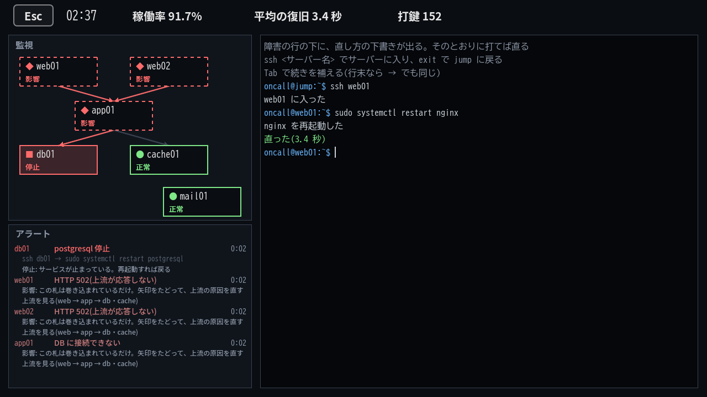
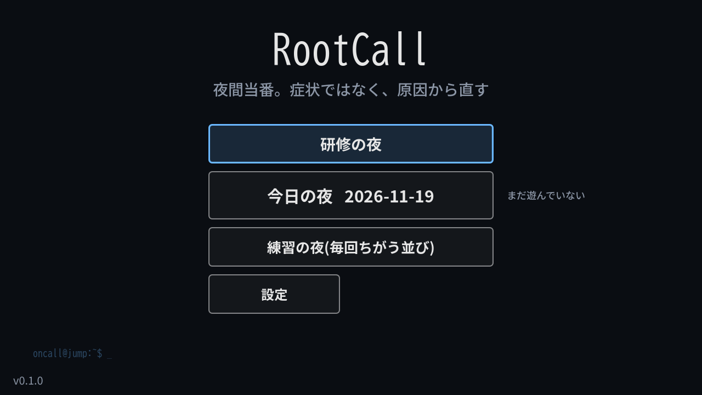
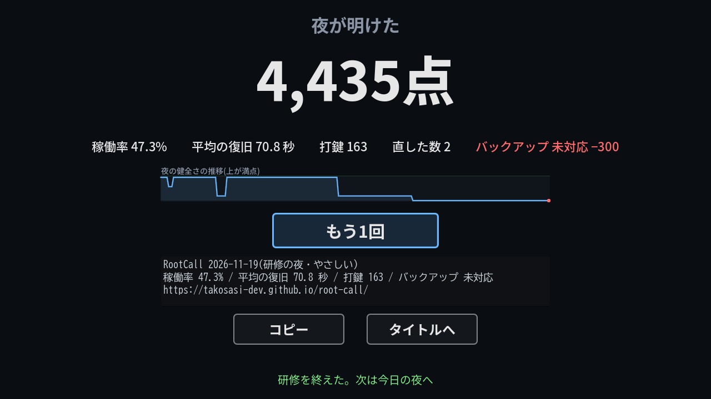

# RootCall

社内 SE の夜間当番になって、4 分の夜に次々と上がる障害を、端末にコマンドを打って直すゲームです。サーバーの間には依存があり、**見えている症状ではなく、原因から直さないと戻りません**。ブラウザで開くだけで遊べます。

**▶ 遊ぶ: https://takosasi-dev.github.io/root-call/** (デスクトップの Chrome・Edge・Firefox。キーボードで遊びます。インストール不要)

<p align="center">
  
</p>

> v0.1.0。コマンドの実行の時間や、障害が悪化するまでの秒数などの調整値は、まだ人に遊んでもらって決めた値ではありません。

## 遊び方

- 左の「監視」に 6 台のサーバーと依存の矢印(web → app → db・cache)、下に「アラート」の一覧が出ます。
- 右の端末で `ssh <サーバー名>` と打ってサーバーに入り、直すコマンドを打ちます。直ると札が緑に戻り、稼働率が戻ります。
- db01 が止まると、app01 と web も巻き込まれます(◆ 影響)。巻き込まれた側を再起動しても直りません。矢印をたどって原因を直します。
- ディスクの逼迫とメモリの漏れは、放っておくと 20〜25 秒でサービスが止まります。
- **Tab** で続きを補えます(行末なら **→** でも同じ)。**↑ ↓** で前に打った行を呼び出せます。打つ量を減らすほど多く捌けます。
- 初めは「研修の夜」から。直し方の下書きが毎回出ます。`help` でコマンドの一覧が出ます。
- Esc で一時停止。

| 障害 | 直し方(そのサーバーで) |
|---|---|
| 停止 | `sudo systemctl restart <サービス>` |
| ディスクの逼迫 | `sudo journalctl --vacuum-size=200M` |
| メモリの漏れ | `sudo systemctl restart app` |
| 証明書の期限切れ | `sudo certbot renew` |
| 送信待ちの詰まり | `sudo postqueue -f` |
| バックアップの失敗 | `sudo systemctl start backup` |

コマンドは対応表に留めた作り物です。本物のシェルではなく、どこにも繋がりません。`rm` や `reboot` のような危ない操作は、ゲームの中でも断られます。

## 今日の夜

「今日の夜」は日付で決まり、同じ日なら誰でも同じ障害の並びです。結果画面の文字をコピーして貼れば比べられます。

```
RootCall 2026-11-19(今日の夜・1回目)
稼働率 86.4% / 平均の復旧 9.8 秒 / 打鍵 412
https://takosasi-dev.github.io/root-call/
```

点 = 稼働率(利用者から見た健全さの平均)を 1/100 % にした物 − 未対応のバックアップ 1 つにつき 300。

<p>
  
  
</p>

## しくみ

- **ゲームの決まりは `core/` にだけ**あります(行の編集・補完・履歴・コマンドの解釈・サーバーの状態・障害・稼働率・点)。画面は `sim.snapshot()` と `sim.events()` を読んで描くだけです。
- 1/120 秒刻みで進め、入力はキーの番号(整数)だけを受けます。同じ種と同じ打鍵の記録なら、Windows・Linux(CI)で同じ結果になることをテストで確かめています。
- 障害の並びは種だけで決まります。テスト用の bot(一番古い障害を直す bot・症状の側を再起動する bot・何もしない bot)に夜を遊ばせて、稼働率を比べています。
- 保存はブラウザの中(localStorage の `root-call/save`)だけです。サーバーとの通信やアクセス解析はありません。

## 動作環境

- Godot 4.7.2-stable(GDScript、レンダラー Compatibility)
- Web 書き出しはスレッド無し・拡張無し

## 開発

```
# テスト(全件成功で終了コード 0)
godot --headless --import
godot --headless --script res://tests/run_tests.gd

# Web 書き出し(書き出しテンプレート 4.7.2 が要る)
godot --headless --export-release "Web" build/web/index.html

# 字体を画面の文字に絞る・効果音を作る(Python)
pip install fonttools
python tools/subset_font.py
python tools/gen_sfx.py

# 書き出した物を窓なしの Chrome で確かめる(Node.js 22 以上)
node tests/web/check.mjs
```

`main` に push すると、GitHub Actions がテスト → Web 書き出し → GitHub Pages への配置を行います(`.github/workflows/pages.yml`)。

## ライセンス

MIT(`LICENSE`)。同梱の字体は SIL Open Font License 1.1 です(`THIRD-PARTY-NOTICES.md`)。
